# Open bugs

This file records bugs that are reported but not fixed. Do not fix a bug when you record it.

The fix approach, size and order for each bug are in [bug-fix-plan.md](bug-fix-plan.md).

Images for a bug are in `plan/bug-images/`. Name each file `BUG-<number>-<n>.<ext>`.

## Entry format

```md
### BUG-<number>: <short title>

- Status: open
- Reported: <YYYY-MM-DD>
- Area: <web | api | game-engine | shared | e2e | ops>
- Steps to reproduce:
  1. ...
- Expected: ...
- Actual: ...
- Images: 
- Notes: ...
```

## Bugs

### BUG-1: Station title deed shows a rent range, not all rent options

- Status: fixed (2026-11-09), checked in the browser
- Reported: 2026-11-09
- Area: web
- Steps to reproduce:
  1. Open a title deed card for a station (for example North Station).
  2. Read the Rent row.
- Expected: The card shows the full rent for 1, 2, 3, and 4 stations owned.
- Actual: The card shows only a range: "Rent $25 to $200".
- Images: 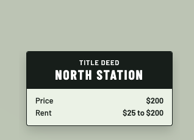
- Notes: The station rent values are $25, $50, $100, and $200 for 1, 2, 3, and 4 stations. Check the rules in `plan/game-rules-reference.md` before the fix.

### BUG-2: Auction is not in a modal dialog (change request)

- Status: fixed (2026-11-09), checked in the browser
- Reported: 2026-11-09
- Area: web
- Type: change request
- Steps to reproduce:
  1. Start an auction (for example for North Station).
- Expected: The auction shows in a modal dialog.
- Actual: The auction shows inline on the game screen, not in a modal dialog.
- Images: 
- Notes: Keep the existing auction content (title deed, current bid, bidders, bid input, quick-bid buttons, Bid and Pass).

### BUG-3: Focus ring on the bid input shows around the inner input only

- Status: fixed (2026-11-09)
- Reported: 2026-11-09
- Area: web
- Steps to reproduce:
  1. Start an auction.
  2. Click or tab to the "Your bid" input.
- Expected: The focus ring shows around the whole field (the box with the "$" sign and the number).
- Actual: The focus ring shows only around the inner HTML input element. The "$" sign is outside the ring.
- Images: 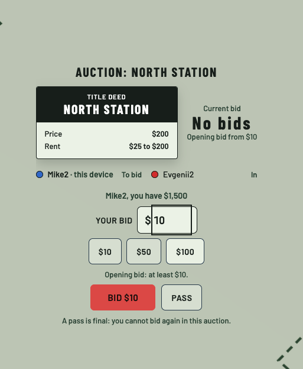
- Notes: A fix can use `:focus-within` on the field wrapper.

### BUG-4: Dice roll animation is cropped and a scrollbar shows

- Status: fixed (2026-11-09)
- Reported: 2026-11-09
- Area: web
- Steps to reproduce:
  1. Roll the dice.
  2. Look at the dice area while the "Rolling..." label shows.
- Expected: Both dice show fully during the animation. No scrollbar shows.
- Actual: The dice area crops the dice (the top of the left die is cut off). A vertical scrollbar shows at the right side of the dice area.
- Images: 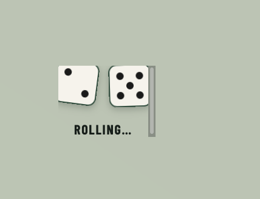
- Notes: The dice container probably has too little height or an overflow setting that lets the rotating dice go outside it.

### BUG-5: Chance and Community Chest cards are not in modal dialogs (change request)

- Status: fixed (2026-11-10)
- Reported: 2026-11-09
- Area: web
- Type: change request
- Steps to reproduce:
  1. Move a player onto a Chance or Community Chest space (or draw a card in another way).
- Expected: The drawn card shows in a modal dialog.
- Actual: The card shows inline on the game screen, with the label "Mike2 drew a card" above it and an OK button below it.
- Images: 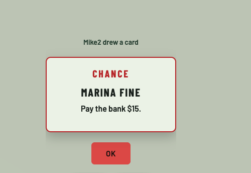
- Notes: Applies to both Chance and Community Chest cards. See also BUG-2 (auction in a modal dialog); the same modal component can serve both.

### BUG-6: Dice pips are red and larger on the face with one pip

- Status: fixed (2026-11-09)
- Reported: 2026-11-09
- Area: web
- Steps to reproduce:
  1. Roll a double 1 (both dice show one pip).
  2. Look at the dice faces.
- Expected: Dice pips (eyes) are always black and always the same size, on all faces.
- Actual: The pip on the face with one pip is red and larger than the pips on the other faces.
- Images: 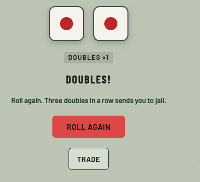
- Notes: The red large pip is a common style for the face with one pip. The request is to remove this special case. Check the other faces for the same problem.

### BUG-7: Board has no card stacks for Chest and Chance (change request)

- Status: fixed (2026-11-10)
- Reported: 2026-11-09
- Area: web
- Type: change request
- Steps to reproduce:
  1. Open a game and look at the center of the 3D board.
- Expected: A card stack shows for Community Chest and for Chance, in the marked places on the board.
- Actual: The board shows only dashed outlines with the labels "CHEST" and "CHANCE". No card stacks are there.
- Images: 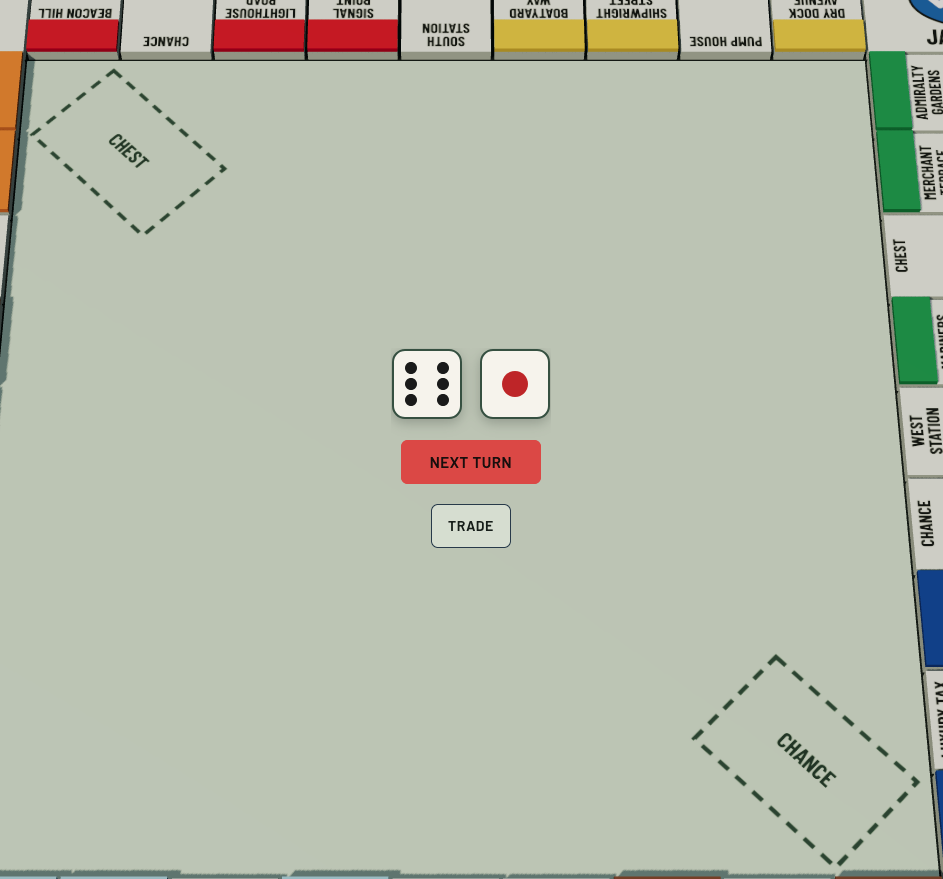
- Notes: The dashed outlines are the places for the stacks. See also BUG-5 (drawn cards in modal dialogs). Preserve the reduced-motion and no-WebGL paths.

### BUG-8: Remove the properties header block and the group labels above property stacks (change request)

- Status: fixed (2026-11-10)
- Reported: 2026-11-09
- Area: web
- Type: change request
- Steps to reproduce:
  1. Open a game in which a player owns properties.
  2. Look at the property stacks below the board.
- Expected: The block with the title "EVGENII2'S PROPERTIES" (with the count and total value, "7 · $820", and the collapse arrow) is not shown. The labels above the property stacks (for example "Brown", "Sky · 3", "Pink · 3" with the check mark) are not shown.
- Actual: The header block and the group labels show on top of the board and the property stacks.
- Images: 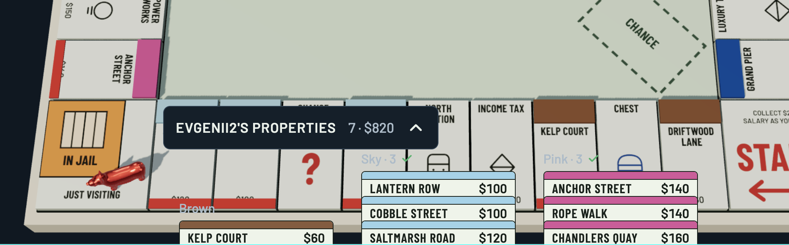
- Notes: The property stacks stay. Only the header block and the labels are removed. The header also has the collapse control, so check that the stacks do not need it.

### BUG-9: Red bar on a board tile covers the property price

- Status: fixed (2026-11-09), checked in the browser
- Reported: 2026-11-09
- Area: web
- Steps to reproduce:
  1. Open a game and look at the board tiles that have a red bar at the bottom (the tiles after Chance on the same side, for example Lantern Row).
- Expected: The price text shows fully and is easy to read. The red bar does not cover it.
- Actual: The red bar at the bottom of the tile overlaps the price. Only the top of the price text shows (for example "$100").
- Images: 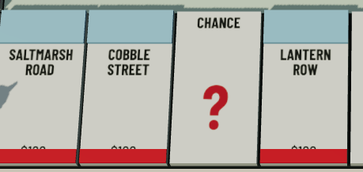
- Notes: The tiles in the image are Saltmarsh Road, Cobble Street, Lantern Row, and Chance. The red bar may be another element, for example an owner marker or a mortgage mark. Find out what it is before the fix.

### BUG-10: Purchase dialog shows only price and base rent (change request)

- Status: fixed (2026-11-09), checked in the browser
- Reported: 2026-11-09
- Area: web
- Type: change request
- Steps to reproduce:
  1. Move a player onto an unowned property (for example Net Loft Road).
  2. Look at the title deed in the purchase dialog.
- Expected: The title deed shows the full property information: price, rent, rent with a color set, rent with 1 to 4 houses, rent with a hotel, house cost, hotel cost, and mortgage value.
- Actual: The title deed shows only the price ("$180") and the base rent ("$14").
- Images: 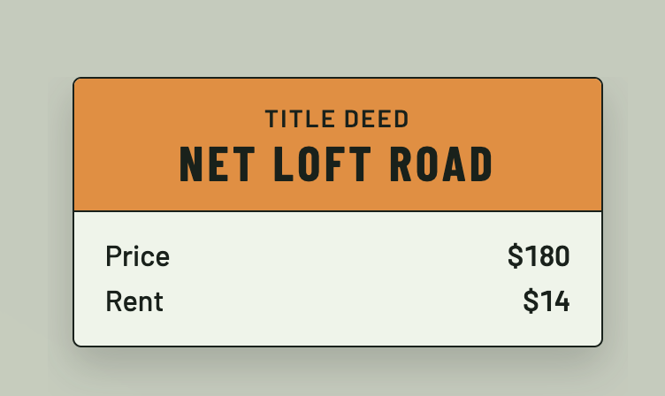
- Notes: See also BUG-1 (full rent options for stations). Check `plan/game-rules-reference.md` and the engine board data for the available values. The same deed component may serve other places, such as the auction.

### BUG-11: Property card stacks do not fit when a player owns many properties (change request, needs a plan)

- Status: fixed (2026-11-10)
- Reported: 2026-11-09
- Area: web
- Type: change request
- Steps to reproduce:
  1. Open a game in which a player owns many properties (28 in the image).
  2. Look at the property stacks below the board.
- Expected: The team plans how to fit many property cards in the available space, with all cards readable.
- Actual: The stacks are in one row. They overlap each other and go outside the screen at the right side (cut-off names and prices, for example "Pay..." and "...ities · 2"). The board is partly hidden behind them.
- Images: 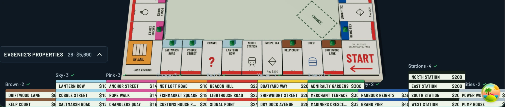
- Notes: This entry asks for a plan, not a quick fix. See BUG-8 (remove the header block and group labels) and BUG-12 (expanded panel).

### BUG-12: Expanded properties panel needs a scroll; show all properties without scroll (change request)

- Status: fixed (2026-11-10)
- Reported: 2026-11-09
- Area: web
- Type: change request
- Steps to reproduce:
  1. Open a game in which a player owns many properties (28 in the image).
  2. Expand the "EVGENII2'S PROPERTIES" panel.
- Expected: All properties fit in the panel without a scroll. The panel can be bigger, and a different way to show the properties is acceptable.
- Actual: The panel shows only some of the color groups (Brown, Sky, Pink, Orange, and the start of Red). The rest is below, and a scrollbar shows at the right side. The panel also covers a large part of the board.
- Images: 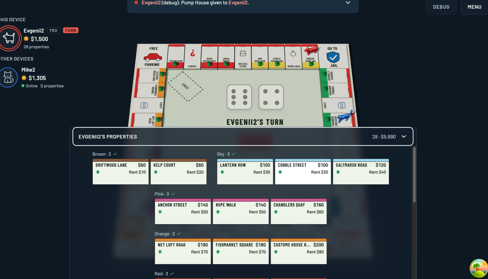
- Notes: Possible directions: a bigger panel, a more compact card, or more columns. Each group has a different number of cards, so a grid layout may use the space better. See BUG-11.

### BUG-13: Board cells are not interactive (change request)

- Status: fixed (2026-11-10)
- Reported: 2026-11-09
- Area: web
- Type: change request
- Steps to reproduce:
  1. Open a game.
  2. Click or tap a cell (property, station, or utility) on the board.
- Expected: A dialog opens with the full property information. If the current player owns the property, they can do all property actions from this dialog (for example build, sell, mortgage, and unmortgage, as far as the rules allow).
- Actual: Board cells do nothing when selected.
- Images: none
- Notes: This depends on the full property information from BUG-10, and it uses the modal dialog from BUG-2 and BUG-5. Keep keyboard access and the no-WebGL path. The server stays the authority for actions, so the dialog sends the same actions as the existing property controls.

### BUG-14: Event log is empty after a page refresh or reconnect

- Status: fixed (2026-11-10)
- Reported: 2026-11-09
- Area: web (and possibly api)
- Steps to reproduce:
  1. Play a game until the event log has entries.
  2. Refresh the page, or lose the connection and reconnect.
  3. Open the event log.
- Expected: The event log keeps the earlier events of the game.
- Actual: The event log is empty and shows "No events yet."
- Images: 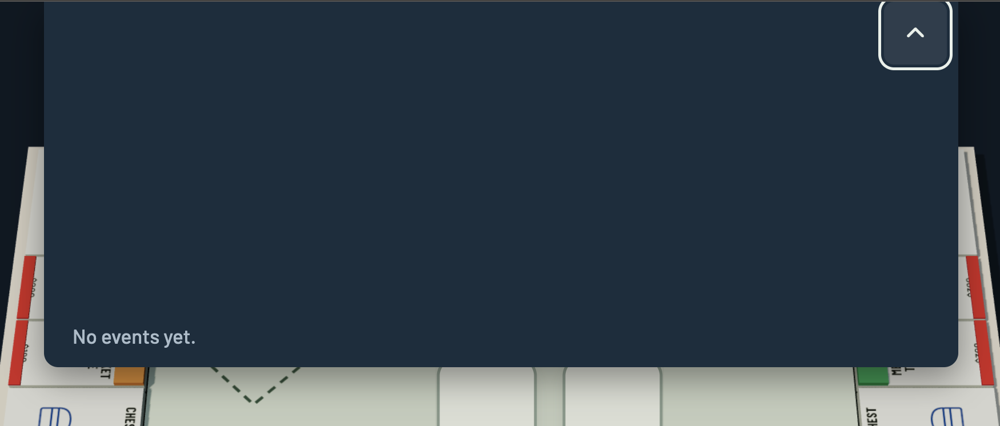
- Notes: The web game store may keep events only in memory and fill them from the live stream. The API stores events with the game, so check if the loader or the SSE resume can send the earlier events (or if a REST endpoint is needed).

### BUG-15: Hot-seat turn change shows a full-screen confirmation overlay (change request)

- Status: fixed (2026-11-10). Browser tests T11 and the core script are updated but not run in this sandbox
- Reported: 2026-11-09
- Area: web
- Type: change request
- Steps to reproduce:
  1. Start a game with hot-seat players on one device.
  2. End a turn so that the next hot-seat player is up.
- Expected: A toast (notification) shows that it is now the next player's turn. The player does not need to confirm. All devices in the game get this notification, not only the hot-seat device (added 2026-11-09).
- Actual: A full-screen overlay shows "Pass to Mike" with the button "I'm Mike, start my turn". The player must press the button to continue.
- Images: 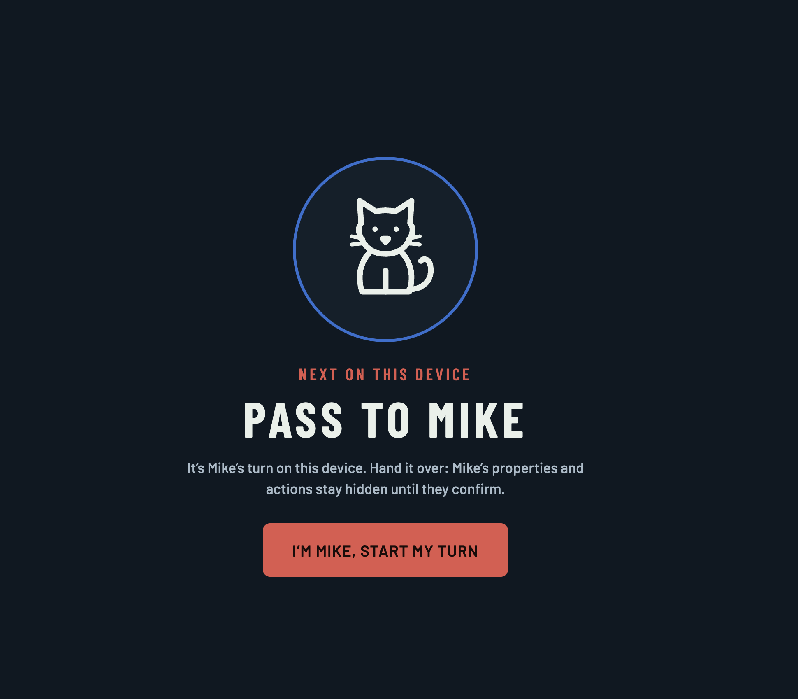
- Notes: The overlay hides the properties and actions of the next player until they confirm. If the overlay is removed, that privacy step is also removed. The request accepts this. Update the related documentation and tests (for example the hot-seat browser tests) when the change is made.

### BUG-16: Token moves to the card's target cell before the player confirms the card (change request)

- Status: fixed (2026-11-10)
- Reported: 2026-11-09
- Area: web
- Type: change request
- Steps to reproduce:
  1. Move a player onto a Chance or Community Chest cell.
  2. Draw a card that moves the player to another cell (for example "Nearest Utility").
  3. Watch the token while the card shows.
- Expected: The token animation stops at the Chance or Chest cell. The token starts to move to the final cell only after the player confirms the card in the modal dialog.
- Actual: The token shows at the final cell (Power Works in the image) while the card still shows and waits for confirmation.
- Images: 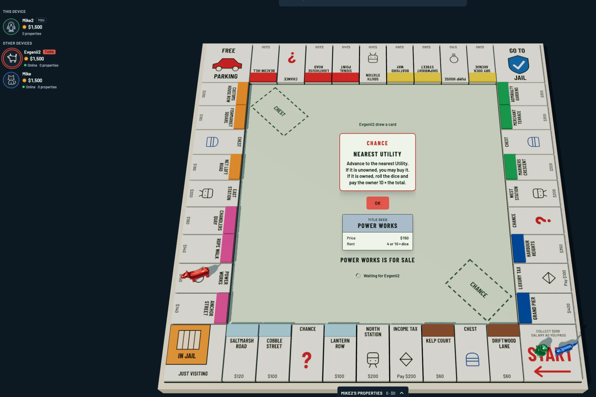
- Notes: The server applies the whole result in one action, so the web store must delay the second movement. Apply this to other players' devices too (they see the card and wait). Preserve the reduced-motion path. See BUG-5 (cards in modal dialogs).

### BUG-17: Add a separate env variable to turn debug mode on and off (change request)

- Status: fixed (2026-11-10)
- Reported: 2026-11-09
- Area: web, api
- Type: change request
- Steps to reproduce:
  1. Start the app (for example with `pnpm dev` or the Docker image).
  2. Look for a way to turn debug mode on or off (the debug button and debug actions in the UI, and the debug routes in the API).
- Expected: A separate environment variable turns debug mode on and off, for both the UI and the API. Debug mode is off when the variable is not set.
- Actual: No separate variable exists for debug mode. Debug features (for example the "DEBUG" button and the debug action "Pump House given to Evgenii2" in the event log) show without such a switch.
- Images: none
- Notes: The name of the variable is not decided yet. The API must refuse debug actions when the variable is off, and the web build must hide the debug UI. Add the variable to `ops/local.env` and the README. Debug mode must be off in production. The existing test seed and short presence grace time must stay disabled in production too.

### BUG-18: Card "Next stop, a Station" does not say that the token goes forward (change request)

- Status: open
- Reported: 2026-11-16
- Area: web and game-engine (card text in `packages/game-engine/src/cards.ts`, cards at lines 24 and 25 for stations, and the "Nearest utility" card at line 26)
- Type: change request
- Steps to reproduce:
  1. Move a player onto the Chance square at index 36 (right side of the board, next to West Station at index 35).
  2. Draw the card "Next stop, a Station".
- Expected: The card text tells the player that the token goes to the next station ahead. A move to North Station (index 5, past Start, with the salary paid) is then not a surprise.
- Actual: The card text says only "Next stop, a Station". The player expected West Station, one square behind the Chance square. The token went to North Station.
- Images: none
- Notes: The engine is correct. The official Monopoly rules say that "nearest" means the next one ahead in the clockwise direction. `plan/game-rules-reference.md` says the same. Only the text changes. Do not change the engine rule. Check if the card title, the card body, or both show in the web card modal. Check the card texts in `plan/game-rules-reference.md` Appendix C and any tests that match the text. Apply the same wording idea to the "Nearest utility" card.

### BUG-19: Grafana "Automatic saves" counter shows 0 after an automatic save

- Status: open
- Reported: 2026-11-16
- Area: ops (and possibly api)
- Steps to reproduce:
  1. Start a game and let the last online player go away, so that the game saves automatically.
  2. Look at the log panel in Grafana. It shows the line "game saved automatically" (version 40) after "presence changed" with status=away.
  3. Look at the "Automatic saves" tile in the Realtime row of the dashboard.
- Expected: The tile shows 1 or more.
- Actual: The tile shows 0. The tile "Away" shows 1 in the same time range, so the presence metric works.
- Images: none (two screenshots: the log panel and the Realtime row)
- Notes: The tile query is `sum(increase(harborfront_realtime_autosaves_total[$__range])) or vector(0)` in `ops/grafana/dashboards/harborfront.json`. The API adds to the counter `harborfront.realtime.autosaves` in `apps/api/src/app.ts` (`deps.metrics.autoSaved()`), right after the save that writes the log line. The code path looks correct. Two causes are likely. First, a Prometheus counter that appears with the value 1 and no earlier sample gives `increase` of 0, so the first save after an API start is not counted. Second, the metric name or the label set in the exported series differs from the name in the query. Check the series in Grafana Explore before the fix. If the first cause is true, the API can create the counter with a value of 0 at start.

### BUG-20: The game has no favicon (change request)

- Status: open
- Reported: 2026-11-23
- Area: web
- Type: change request
- Steps to reproduce:
  1. Open the game in a browser.
  2. Look at the browser tab.
- Expected: The tab shows an icon for the game: a gold coin with a capital letter M at the center.
- Actual: The tab shows the default browser icon. `apps/web/index.html` has no icon link, and `apps/web/public/` has only the `sounds` folder.
- Images: none
- Notes: Make an SVG icon, and add a PNG fallback and an Apple touch icon if needed. Take the gold color from `apps/web/src/styles/tokens.css`. Make sure that the icon is readable at 16 px. Make sure that the Vite build, the Docker image and nginx serve the files from `public/`. Ask the user to approve the design before you save a new design artifact.

### BUG-21: Board and tokens disappear after a WebGL context loss (critical)

- Status: fixed. After a context restore, the scene gets a new environment map and draws again (`BoardScene.tsx`, `Tokens.tsx`, `PawnStage.tsx`). Test: `apps/e2e/tests/webgl-context-loss.spec.ts`. The real trigger of the loss is still unknown.
- Reported: 2026-11-23
- Severity: critical. The game cannot be played without the board.
- Area: web (three.js scene: `apps/web/src/scene/Tokens.tsx`, `apps/web/src/scene/BoardScene.tsx`, `useStudioEnvironment`)
- Steps to reproduce:
  1. Play a game for a few steps. The exact trigger is not known.
  2. Watch the board and the tokens.
- Expected: The board and the tokens stay on the screen for the whole game. If the WebGL context is lost, the scene comes back after the context is restored.
- Actual: After a few steps, the board and the tokens disappear. After some time, the board and the tokens come back, but the tokens are black with only a little color. Only the HTML parts show: the player list, the dice, the buttons and the property cards. Earlier, the tokens sometimes lost their colors and looked unlit. This is probably the same fault in a lighter form. The browser console shows two lines: `THREE.WebGLRenderer: Context Lost.` and `THREE.WebGLRenderer: Context Restored.`
- Images: 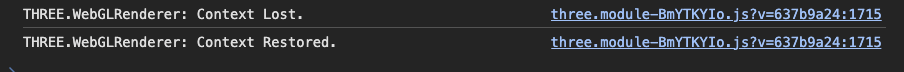 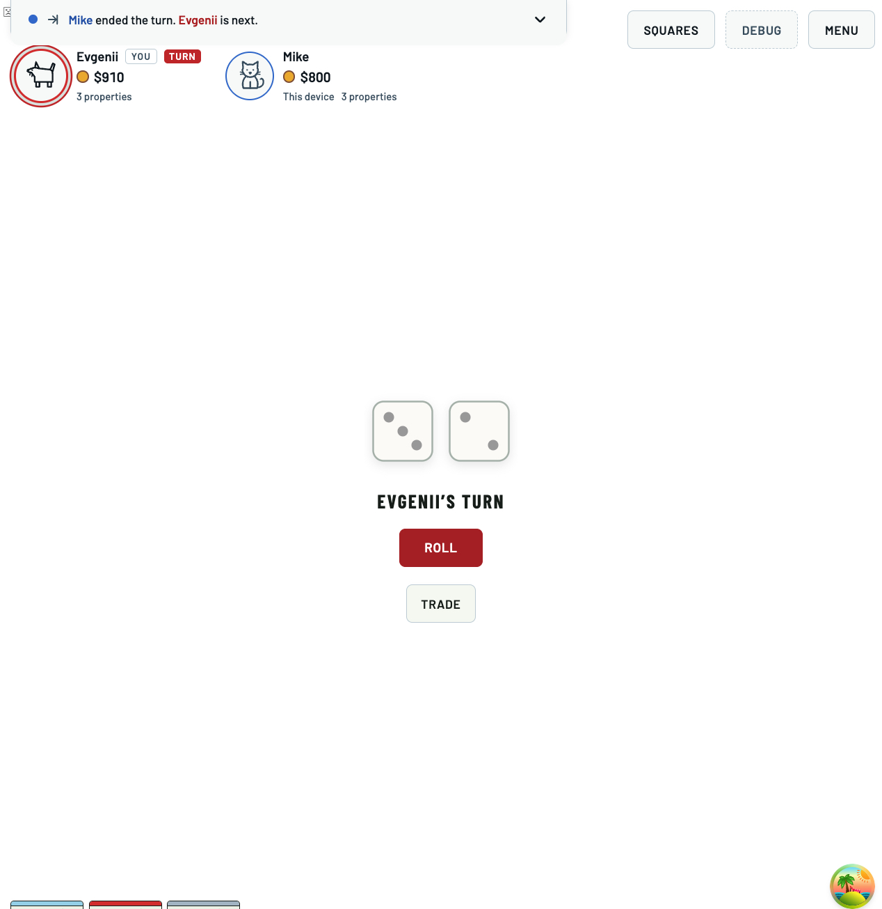 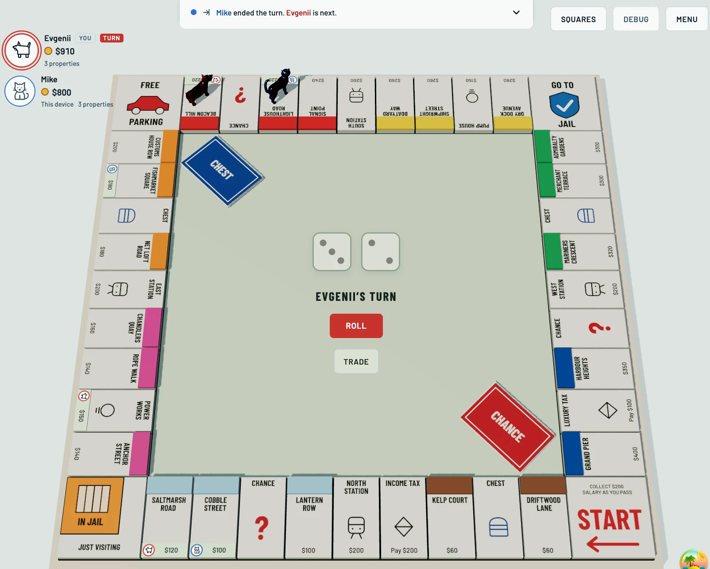
- Notes: The console lines show that the browser lost the WebGL context and restored it. After the restore, the scene does not draw again. Three.js restores its own textures and buffers, but objects that the app made by hand can stay invalid. Check these first: the studio environment map (`studioEnvironment(gl)` in `useStudioEnvironment`) and any render target or canvas texture. They can stay empty after a restore. This also explains the black tokens after the restore: the board materials use basic or simple lighting and recover, but the token materials need the environment map for their light, and it stays empty. Check if `PawnStage.tsx` or another second renderer runs at the same time, because many WebGL contexts in one page make the browser drop the oldest one. Check the GPU memory use of the scene (texture sizes, number of materials). Add a handler for `webglcontextlost` and `webglcontextrestored` on the canvas. In the handler, call `preventDefault` on loss, then build the environment map again and force a new frame after the restore. Show a fallback or a reload message if the scene does not come back. Check the reduced-motion and no-WebGL paths after the fix.

### BUG-22: A remote player cannot connect again; "player is connecting" stays on screen

- Status: open
- Reported: 2026-11-23
- Area: web and api (`apps/web/src/realtime/SseHttpClient.ts`, `apps/web/src/screens/game/turn/ActionBar.tsx`, API presence and SSE code)
- Steps to reproduce:
  1. Start a game with a remote player.
  2. The remote player loses the connection. The cause is not known.
  3. The remote player tries to join the game again.
- Expected: The player joins the game again when the network works. The message "player is connecting" goes away.
- Actual: The player cannot join again. The other players always see the message "player is connecting". At the same time, the network of the player was good and the game server had no problem.
- Images: none
- Notes: This happened one time. The cause is not known. Possible causes to check: the client stops its retries after an error, or after the cookie session ends. The SSE resume with the last event ID fails. The server keeps the seat in the `reconnecting` presence state after the stream closes. A timer for the grace time does not start again. Compare with the presence rules in `plan/milestone-3-tasks.md`. If it happens again, save the browser console, the network log, and the API log of the player and of the game.

### BUG-23: Event log does not show turn numbers (change request)

- Status: open
- Reported: 2026-11-23
- Area: web (event log: `apps/web/src/screens/game/log/describe.ts`, texts in `apps/web/src/i18n/en.ts` and `ru.ts`)
- Type: change request
- Steps to reproduce:
  1. Play a few turns.
  2. Read the event log.
- Expected: The log shows the turn number for each turn. The numbers start at 0.
- Actual: The log shows no turn numbers.
- Images: none
- Notes: Check if the engine state has a turn counter and if the events carry it. If a turn counter is not in the state or the events, a change to the engine and to the shared schemas is needed, and `drift.test.ts` must stay in step. Decide what "starting from 0" means for the first turn of the game: the first turn is turn 0. Decide where the number shows: a header line for each turn, or a prefix on each line. Update both the English and the Russian texts.

### BUG-24: Movement log shows only the destination square (change request)

- Status: open
- Reported: 2026-11-23
- Area: web (`PlayerMoved` case in `apps/web/src/screens/game/log/describe.ts`, text key `log.moved` in `apps/web/src/i18n/en.ts` and `ru.ts`)
- Type: change request
- Steps to reproduce:
  1. Roll the dice and move a token.
  2. Read the movement line in the event log.
- Expected: The line shows the starting square and the destination square, for example "Evgenii moved from Saltmarsh Road to North Station."
- Actual: The line shows only the destination square.
- Images: none
- Notes: Check if the `PlayerMoved` event has the starting position. If it has only the destination, add the starting position to the event, or find it from the earlier state of the player in the log code. If the event changes, update the shared schemas, `drift.test.ts` and the tests that match the text. Make sure that moves from a card, a move to jail and a move back work with the new text. Update both the English and the Russian texts.
